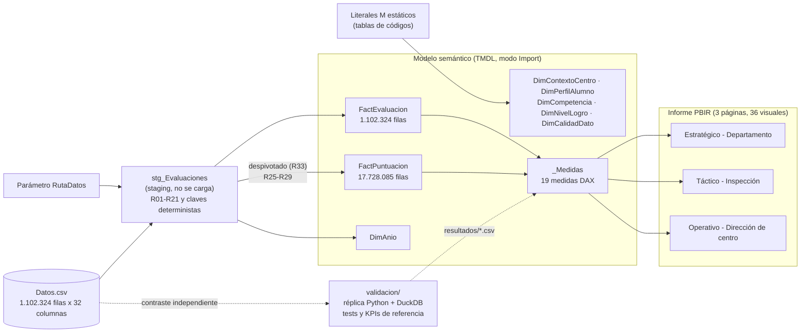
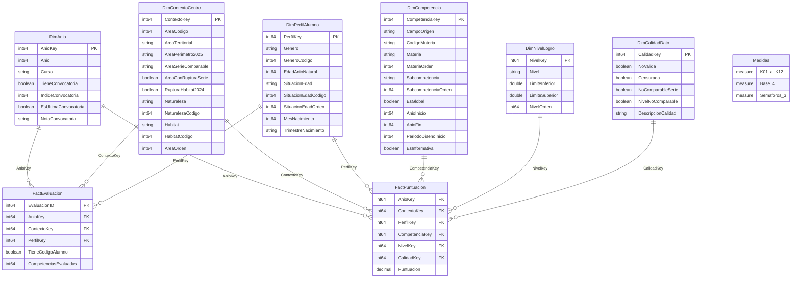

# Modelo de datos y diccionario del CMI de Educación Primaria

**Proyecto:** Diseño e implementación de un Cuadro de Mando Integral (CMI) en Power BI para el soporte a la toma de decisiones en la educación primaria de Cataluña (TFG, FIB-UPC).
**Autora:** Kiara Rodríguez Uribe.
**Alcance:** versión MVP v0.1 del modelo semántico `PowerBI/CMI_Educacion_Primaria.SemanticModel` y del informe `PowerBI/CMI_Educacion_Primaria.Report`.
**Documentos relacionados:** `01_Informe_calidad_datos.md` (auditoría y reglas R01–R34), `trabajo_en_curso/contrato_diseno.md` (contrato de diseño) y `validacion/README.md` (réplica de referencia en Python).

Todo lo que se describe aquí procede de los ficheros del proyecto: las definiciones TMDL del modelo (tablas, columnas, descripciones, consultas M y medidas DAX), la definición PBIR del informe y los resultados de la réplica de validación. Las referencias «R0x» remiten a las reglas de limpieza de la sección 5 del informe de calidad.

---

## 1. Arquitectura de la solución

La solución sigue una arquitectura de cuatro capas, todas en modo *Import* dentro de un único proyecto de Power BI (formato PBIP, con el modelo en TMDL y el informe en PBIR, ambos en texto y versionables en git):

1. **Origen.** El fichero `Datos.csv` (*Avaluació de sisè d'educació primària*, Portal de Dades Obertes de la Generalitat; 1.102.324 registros y 32 columnas). La ruta se configura con el parámetro de consulta `RutaDatos` (por defecto `C:\TFG_Project\Datos.csv`, obligatorio).
2. **ETL en Power Query (M).** Una consulta de *staging*, `stg_Evaluaciones`, que no se carga en el modelo, lee el CSV y aplica las reglas de limpieza R01–R21. De ella derivan las dos tablas de hechos y `DimAnio`. Las demás dimensiones son tablas estáticas definidas en el propio código M.
3. **Modelo semántico dimensional (Kimball).** Un esquema en estrella con dos tablas de hechos que comparten tres dimensiones conformadas (`DimAnio`, `DimContextoCentro` y `DimPerfilAlumno`), tres dimensiones propias de las puntuaciones (`DimCompetencia`, `DimNivelLogro` y `DimCalidadDato`) y una tabla de medidas (`_Medidas`) con 19 medidas DAX.
4. **Informe PBIR.** Tres páginas (lienzo de 1280 × 720) orientadas a tres perfiles de decisión: «Estratégico - Departamento» (12 visuales), «Táctico - Inspección» (11) y «Operativo - Dirección de centro» (13), 36 visuales en total.

En paralelo, la carpeta `validacion/` contiene una réplica independiente de la ETL y de las medidas en Python (pandas y DuckDB) que sirve para contrastar el modelo cifra a cifra (27 tests de integridad y 6 ficheros de KPIs de referencia).

Las consultas M se organizan en cuatro grupos (`queryGroup`): **Parámetros** (`RutaDatos`), **Staging** (`stg_Evaluaciones`), **Dimensiones** y **Hechos**.

---

## 2. Esquema en estrella

El modelo tiene 9 relaciones, todas de muchos a uno, con filtrado en una sola dirección (de la dimensión al hecho) y activas. Las dos tablas de hechos no se relacionan entre sí: comparten las dimensiones conformadas de año, contexto del centro y perfil del alumno, de modo que un mismo segmentador filtra a la vez el recuento de alumnado y las puntuaciones.

*Nota:* en el diagrama la tabla `_Medidas` aparece como `Medidas` porque la sintaxis de Mermaid no admite identificadores que empiecen por guion bajo. Es una tabla sin columnas ni relaciones que solo agrupa las medidas.

| Relación (desde → hacia) | Cardinalidad | Dirección del filtro |
|---|---|---|
| `FactPuntuacion[AnioKey]` → `DimAnio[AnioKey]` | Muchos a uno | Única |
| `FactPuntuacion[ContextoKey]` → `DimContextoCentro[ContextoKey]` | Muchos a uno | Única |
| `FactPuntuacion[PerfilKey]` → `DimPerfilAlumno[PerfilKey]` | Muchos a uno | Única |
| `FactPuntuacion[CompetenciaKey]` → `DimCompetencia[CompetenciaKey]` | Muchos a uno | Única |
| `FactPuntuacion[NivelKey]` → `DimNivelLogro[NivelKey]` | Muchos a uno | Única |
| `FactPuntuacion[CalidadKey]` → `DimCalidadDato[CalidadKey]` | Muchos a uno | Única |
| `FactEvaluacion[AnioKey]` → `DimAnio[AnioKey]` | Muchos a uno | Única |
| `FactEvaluacion[ContextoKey]` → `DimContextoCentro[ContextoKey]` | Muchos a uno | Única |
| `FactEvaluacion[PerfilKey]` → `DimPerfilAlumno[PerfilKey]` | Muchos a uno | Única |

---

## 3. Granularidad de las tablas de hechos

| Tabla | Grano (una fila representa…) | Filas | Base de |
|---|---|---|---|
| `FactEvaluacion` | Un registro de `Datos.csv`: un alumno evaluado en una convocatoria. | 1.102.324 | Medida `Alumnos evaluados`. |
| `FactPuntuacion` | Una puntuación no nula de un registro en una de las 24 columnas de puntuación (competencia global o subcompetencia), tras el despivotado (R33). | 17.728.085 (4.769.851 globales y 12.958.234 de subcompetencias) | K01–K12, semáforos y medidas base de puntuación. |

Las dos cifras coinciden con las de control fijadas en el informe de calidad (secciones 5 y 6.1) y con las que obtiene la réplica en Python (`validacion/test_modelo.py`). En `FactPuntuacion` no se elimina ninguna celda: las puntuaciones problemáticas se conservan y se caracterizan con `CalidadKey` (sección 7.2).

---

## 4. Diccionario de datos

Convenciones de todas las tablas: nombres de tablas y columnas en castellano, sin tildes ni espacios (PascalCase); claves `int64` sin resumen automático (`summarizeBy: none`); en las dimensiones, las columnas de código y de orden están ocultas y actúan como `sortByColumn` del atributo de texto correspondiente; en las tablas de hechos, todas las columnas están ocultas, de modo que el usuario solo trabaja con atributos de dimensión y con medidas. El modelo tiene `discourageImplicitMeasures` activado y la referencia cultural `es-ES`.

### 4.1. `FactEvaluacion`

Origen: consulta `FactEvaluacion` sobre `stg_Evaluaciones`.

| Columna | Tipo | Visible | Descripción | Origen / regla |
|---|---|---|---|---|
| `EvaluacionID` | int64 | Oculta | Posición del registro en `Datos.csv` (1..N), asignada antes de cualquier filtro. | Índice de `Table.AddIndexColumn` (R01). |
| `AnioKey` | int64 | Oculta | Año de la convocatoria (relación con `DimAnio`). | `ANY` convertido a entero. |
| `ContextoKey` | int64 | Oculta | Contexto del centro (relación con `DimContextoCentro`). | Clave determinista (sección 5); R10–R14. |
| `PerfilKey` | int64 | Oculta | Perfil del alumno (relación con `DimPerfilAlumno`). | Clave determinista (sección 5); R09, R16–R21. |
| `TieneCodigoAlumno` | boolean | Oculta | VERDADERO si el registro tiene `CODI_ALUMNE`. El código no se carga por privacidad. | `CODI_ALUMNE` no nulo (R06). |
| `CompetenciasEvaluadas` | int64 | Oculta | Número de puntuaciones globales informadas en el registro. | Recuento de no nulos entre `PCAT`, `PCAST`, `PMAT`, `PANG`, `PFRAN` y `PMED`. |

### 4.2. `FactPuntuacion`

Origen: consulta `FactPuntuacion` sobre `stg_Evaluaciones` (despivotado de las 24 columnas de puntuación).

| Columna | Tipo | Visible | Descripción | Origen / regla |
|---|---|---|---|---|
| `AnioKey` | int64 | Oculta | Año de la convocatoria. | Heredada de `stg_Evaluaciones`. |
| `ContextoKey` | int64 | Oculta | Contexto del centro. | Heredada de `stg_Evaluaciones`. |
| `PerfilKey` | int64 | Oculta | Perfil del alumno. | Heredada de `stg_Evaluaciones`. |
| `CompetenciaKey` | int64 | Oculta | Competencia evaluada (1–24). | Búsqueda en un registro M estático `CampoOrigen → clave`, sin combinar consultas. |
| `NivelKey` | int64 | Oculta | Nivel de logro; 0 en subcompetencias. | R29: < 55 → 1; [55, 70) → 2; [70, 85) → 3; ≥ 85 → 4. |
| `CalidadKey` | int64 | Oculta | Máscara de calidad de la puntuación (0–15). | Según el par (columna, año): R25–R28. |
| `Puntuacion` | decimal (decimal fijo), formato `0.00` | Oculta | Puntuación 0–100 con 2 decimales. | Conversión es-ES y validación de rango (R02); rotaciones corregidas (R03, R04). |

### 4.3. `DimAnio` (17 filas: 2009–2025)

Origen: derivada de los años distintos de `stg_Evaluaciones`; genera un miembro por año de 2009 al último con datos, incluido 2020.

| Columna | Tipo | Visible | Descripción | Origen / regla |
|---|---|---|---|---|
| `AnioKey` | int64 | Oculta | Clave del año (igual a `Anio`). | `Anio`. |
| `Anio` | int64 | Visible | Año natural de la convocatoria. | Columna `ANY`. |
| `Curso` | string | Visible | Curso escolar, p. ej. «2016-2017». Se ordena por `Anio`. | `(Anio − 1) & "-" & Anio`. |
| `TieneConvocatoria` | boolean | Visible | VERDADERO si ese año hubo prueba y hay datos (FALSO en 2020). | R22. |
| `IndiceConvocatoria` | int64 | Oculta | Número de orden 1..N de las convocatorias con datos; vacío en 2020. | R22; base de las comparaciones temporales. |
| `EsUltimaConvocatoria` | boolean | Visible | VERDADERO en el último año con datos. | `Anio` = máximo de los datos. |
| `NotaConvocatoria` | string | Visible | Advertencia: «Sin prueba por la COVID-19» (2020); «Primera convocatoria tras la COVID-19 (se compara con 2019)» (2021); vacía en el resto. | R22. |

### 4.4. `DimContextoCentro` (120 filas: 15 áreas × 2 naturalezas × 4 hábitats)

Origen: tabla estática en M (producto cartesiano de las tablas de códigos del contrato, sección 5.1).

| Columna | Tipo | Visible | Descripción | Origen / regla |
|---|---|---|---|---|
| `ContextoKey` | int64 | Oculta | Clave determinista. | `AreaCodigo·100 + NaturalezaCodigo·10 + HabitatCodigo`. |
| `AreaCodigo` | int64 | Oculta | Código del área: 3 = Barcelona Comarques hasta 2023; 4 = Barcelona Comarques en 2024 (perímetro del Barcelonès); 99 = desconocida. | R13, R14. |
| `AreaTerritorial` | string | Visible | Área territorial tal como la publica el Departament (los códigos 3 y 4 comparten «Barcelona Comarques»). Se ordena por `AreaOrden`. | `AREA_TERRITORIAL`; R13. |
| `AreaPerimetro2025` | string | Visible | Área expresada con el perímetro territorial vigente en 2025. | R14. |
| `AreaSerieComparable` | string | Visible | Agrupación de áreas con serie temporal comparable a pesar de los cambios de perímetro de 2024–2025. | R14. |
| `AreaConRupturaSerie` | boolean | Visible | VERDADERO si el área cambió de perímetro y su serie no es comparable sin agrupar. | R14. |
| `RupturaHabitat2024` | boolean | Visible | VERDADERO en Girona y Maresme - Vallès Oriental, cuya clasificación de hábitat cambió en 2024. | R15. |
| `Naturaleza` | string | Visible | Titularidad: «Pública» o «Privada» (incluye la concertada). Se ordena por `NaturalezaCodigo`. | `NATURALESA`; R10. |
| `NaturalezaCodigo` | int64 | Oculta | 1 = Pública, 2 = Privada. | R10. |
| `Habitat` | string | Visible | Tamaño del municipio: «No fiable», «Hasta 10.000 hab.», «De 10.001 a 100.000 hab.», «Más de 100.000 hab.». Se ordena por `HabitatCodigo`. | `HÀBITAT`; R11, R12. |
| `HabitatCodigo` | int64 | Oculta | 0 = No fiable, 1, 2, 3 (tramos anteriores). | R11, R12. |
| `AreaOrden` | int64 | Oculta | Orden de presentación (= `AreaCodigo`, salvo el código 4, que toma el 3). | Contrato §5.1. |

Valores de `AreaSerieComparable`: «Lleida + Alt Pirineu i Aran» (Lleida y Alt Pirineu i Aran); «Barcelonès-Penedès y áreas afectadas» (Barcelona Comarques en sus dos perímetros, Barcelonès, Catalunya Central, Penedès y Tarragona); el propio nombre del área en Baix Llobregat, Consorci d'Educació de Barcelona, Girona, Maresme - Vallès Oriental, Terres de l'Ebre, Vallès Occidental y Desconocida.

### 4.5. `DimPerfilAlumno` (182 filas: 2 géneros × 7 combinaciones edad/situación × 13 meses)

Origen: tabla estática en M. Combinaciones (edad, situación) válidas: (10, 4), (11, 4), (12, 1), (13, 2), (14, 3), (sin edad, 8) y (sin edad, 9); meses 0–12 (0 = no informado).

| Columna | Tipo | Visible | Descripción | Origen / regla |
|---|---|---|---|---|
| `PerfilKey` | int64 | Oculta | Clave determinista. | `GeneroCodigo·100000 + SituacionEdadCodigo·10000 + (EdadAnioNatural o 0)·100 + MesNacimiento`. |
| `Genero` | string | Visible | «Niña» o «Niño». Se ordena por `GeneroCodigo`. | `GENERE`; R09. |
| `GeneroCodigo` | int64 | Oculta | 1 = Niña, 2 = Niño. | R09. |
| `EdadAnioNatural` | int64 | Visible | Edad cumplida en el año natural de la prueba (10–14); vacía si falta, está fuera de rango, es 2010 o la fecha es de relleno. | `ANY − ANY_NAIXEMENT`; R16–R19. |
| `SituacionEdad` | string | Visible | Adelantado, Edad teórica (12 años), Retraso de 1 año, Retraso de 2 años, No fiable (2010) o Desconocida. Se ordena por `SituacionEdadOrden`. | R21. |
| `SituacionEdadCodigo` | int64 | Oculta | 1 = edad teórica, 2 = retraso de 1 año, 3 = retraso de 2 años, 4 = adelantado, 8 = no fiable (2010), 9 = desconocida. | R21. |
| `SituacionEdadOrden` | int64 | Oculta | Orden de presentación (4, 1, 2, 3, 8, 9). | Contrato §3. |
| `MesNacimiento` | int64 | Visible | Mes de nacimiento 1–12; vacío si no está informado o es inválido. | `MES_NAIXEMENT`; R16. |
| `TrimestreNacimiento` | string | Visible | «T1»–«T4» o «No informado». | Derivado de `MesNacimiento`. |

### 4.6. `DimCompetencia` (24 filas)

Origen: tabla estática en M (contrato §5.2); una fila por cada columna de puntuación del CSV.

| Columna | Tipo | Visible | Descripción | Origen / regla |
|---|---|---|---|---|
| `CompetenciaKey` | int64 | Oculta | Clave de la competencia (1–24). | Contrato §5.2. |
| `CampoOrigen` | string | Visible | Nombre de la columna en `Datos.csv` (p. ej. `PCAT_CL`). | Cabecera del CSV. |
| `CodigoMateria` | string | Visible | Código de la materia: columna de su global (`PCAT`, `PCAST`, `PMAT`, `PANG`, `PFRAN`, `PMED`). | Contrato §5.2. |
| `Materia` | string | Visible | Lengua catalana, Lengua castellana, Matemáticas, Lengua inglesa, Lengua francesa o Ciencias. Se ordena por `MateriaOrden`. | Informe de calidad §6.6. |
| `MateriaOrden` | int64 | Oculta | Orden de presentación de las materias (1–6). | Contrato §5.2. |
| `Subcompetencia` | string | Visible | Subcompetencia evaluada, o «Global». Se ordena por `SubcompetenciaOrden`. | Informe de calidad §6.6. |
| `SubcompetenciaOrden` | int64 | Oculta | Orden único por texto: 0 Global, 1 Comprensión lectora, 2 Comprensión oral, 3 Expresión escrita, 4–6 matemáticas, 7–9 ciencias. | Contrato §5.2. |
| `EsGlobal` | boolean | Visible | VERDADERO si es la puntuación global de la materia (base de K01, K03, K06 y K10–K12). | Contrato §5.2. |
| `AnioInicio` | int64 | Visible | Primer año con datos de la competencia. | Informe de calidad §4.5. |
| `AnioFin` | int64 | Visible | Último año de la competencia; vacío si sigue vigente (todas lo están). | Informe de calidad §4.5. |
| `PeriodoDisenoInicio` | int64 | Visible | Primer año del diseño actual de la prueba; K10 y K11 solo comparan años desde él. | R32. |
| `EsInformativa` | boolean | Visible | VERDADERO para el francés (muestra pequeña): no entra en K09 ni en K12. | R30. |

### 4.7. `DimNivelLogro` (5 filas)

Origen: tabla estática en M. Los umbrales 55/70/85 son provisionales e internos del TFG; no son los niveles oficiales.

| Columna | Tipo | Visible | Descripción | Origen / regla |
|---|---|---|---|---|
| `NivelKey` | int64 | Oculta | 0 = No aplica (subcompetencia), 1 = Bajo, 2 = Medio-bajo, 3 = Medio-alto, 4 = Alto. | R29. |
| `Nivel` | string | Visible | Nombre del nivel. Se ordena por `NivelOrden`. | R29. |
| `LimiteInferior` | double, formato `0.00` | Visible | Límite inferior del nivel (incluido): 0, 55, 70, 85; vacío en el nivel 0. | R29. |
| `LimiteSuperior` | double, formato `0.00` | Visible | Límite superior (excluido, salvo 100 en Alto): 55, 70, 85, 100; vacío en el nivel 0. | R29. |
| `NivelOrden` | int64 | Oculta | Orden de presentación (0–4). | Contrato §3. |

### 4.8. `DimCalidadDato` (16 filas)

Origen: tabla estática en M; cada fila es una combinación de los 4 bits de calidad.

| Columna | Tipo | Visible | Descripción | Origen / regla |
|---|---|---|---|---|
| `CalidadKey` | int64 | Oculta | Máscara: 1 NoValida + 2 Censurada + 4 NoComparableSerie + 8 NivelNoComparable (0 = válido). | R25–R28. |
| `NoValida` | boolean | Visible | Puntuación no válida (expresión escrita de inglés 2015). K02 la excluye. | R25 (bit 1). |
| `Censurada` | boolean | Visible | Distribución censurada por un suelo artificial (catalán EE 2018; inglés global, CO y CE 2015). K03 y K06 la excluyen. | R26 (bit 2). |
| `NoComparableSerie` | boolean | Visible | Escala no comparable con el resto de la serie temporal. | R27 (bit 4). |
| `NivelNoComparable` | boolean | Visible | El porcentaje por nivel de logro no es comparable (solo globales). K03 la excluye. | R28 (bit 8). |
| `DescripcionCalidad` | string | Visible | «Válido» o la lista de problemas separados por «; ». Se ordena por `CalidadKey`. | Derivada de los bits. |

Asignación de bits por (columna, año) en la consulta `FactPuntuacion`:

| Bit | Regla | Columnas y años |
|---|---|---|
| 1 `NoValida` | R25 | `PANG_EE` 2015 |
| 2 `Censurada` | R26 | `PCAT_EE` 2018; `PANG`, `PANG_CO`, `PANG_CE` 2015 |
| 4 `NoComparableSerie` | R27 | `PANG_CO` y `PCAT_CL` 2011; `PANG_EE` 2013–2016; `PANG_CO` y `PANG_CE` 2015–2016; `PMAT_NC`, `PMAT_EFM`, `PMAT_CR` 2015 |
| 8 `NivelNoComparable` | R28 | `PANG` 2015 y 2016; `PMAT` 2015 y 2019; `PCAT` 2018; `PFRAN` 2022 |

### 4.9. `_Medidas` (19 medidas)

Tabla sin columnas que agrupa las medidas en carpetas de visualización. Todas las medidas tienen una `description` en el modelo; aquí se resumen. Las reglas comunes son: «global» = `DimCompetencia[EsGlobal] = TRUE`; «Cataluña» = sin filtros de `DimContextoCentro`; mínimo muestral de 30 puntuaciones (si no se alcanza, BLANK); comparaciones temporales por `DimAnio[IndiceConvocatoria]`, nunca por `Anio − 1`.

| Medida | Carpeta | Formato | Descripción resumida |
|---|---|---|---|
| `Alumnos evaluados` | 0. Base | `#,0` | Filas de `FactEvaluacion`; no le afectan los filtros de competencia, nivel ni calidad. |
| `Puntuaciones globales` | 0. Base | `#,0` | Filas de `FactPuntuacion` globales; tamaño muestral del mínimo de K01. |
| `Puntuación media` | 0. Base | `0.0` | Media sin filtro de competencia; uso técnico de conciliación. |
| `Puntuación media Cataluña` | 0. Base | `0.0` | K01 sin filtros de `DimContextoCentro`. |
| `K01 Puntuación media competencia` | 1. Rendimiento académico | `0.0` | Media de las globales, con mínimo muestral. |
| `K02 Puntuación media subcompetencia` | 1. Rendimiento académico | `0.0` | Media de las subcompetencias sin las no válidas. |
| `K03 % alumnado nivel bajo` | 1. Rendimiento académico | `0.0%` | % de globales en nivel Bajo, sin censuradas ni niveles no comparables. |
| `K04 Brecha de género (Niños - Niñas)` | 2. Equidad e inclusión | `+0.0;-0.0;0.0` | K01 Niño − K01 Niña. |
| `K05 Brecha pública - privada` | 2. Equidad e inclusión | `+0.0;-0.0;0.0` | K01 Pública − K01 Privada. |
| `K06 Dispersión de resultados` | 2. Equidad e inclusión | `0.0` | STDEV.P de las globales sin censuradas. |
| `K07 Desviación respecto a Cataluña` | 3. Territorio y entorno | `+0.0;-0.0;0.0` | K01 − `Puntuación media Cataluña`. |
| `K08 Diferencia urbano - rural` | 3. Territorio y entorno | `+0.0;-0.0;0.0` | K01 hábitat 3 − K01 hábitat 1; el hábitat 0 nunca entra. |
| `K09 Posición del área` | 3. Territorio y entorno | `0` | Ranking denso por K01 entre áreas, sin «Desconocida» ni competencias informativas. |
| `K10 Variación interanual` | 4. Eficiencia y progreso | `+0.0;-0.0;0.0` | K01 actual − K01 de la convocatoria anterior, con periodo de diseño comparable. |
| `K11 Tendencia 5 convocatorias` | 4. Eficiencia y progreso | `+0.0;-0.0;0.0` | (K01(i) − K01(i−4)) / 4. |
| `K12 % competencias que mejoran` | 4. Eficiencia y progreso | `0.0%` | % de materias no informativas con K10 ≥ 1. |
| `Estado K01` | 5. Semáforos | `0` | 1/0/−1 según K07 (±1) con filtro de contexto, o según K10 (±0,5) sin él. |
| `Estado K03` | 5. Semáforos | `0` | 1/0/−1 según K03 − K03 de Cataluña (±2 puntos porcentuales). |
| `Estado K10` | 5. Semáforos | `0` | 1/0/−1 según K10 (±0,5). |

La definición completa de cada indicador se recogerá en `03_Fichas_KPI.md`.

---

## 5. Claves deterministas y dimensiones *junk* estáticas

### 5.1. Fórmulas

Ninguna clave se obtiene combinando consultas (*merge*): todas se calculan con aritmética sobre los códigos ya normalizados en `stg_Evaluaciones`, y las dimensiones estáticas aplican exactamente la misma fórmula al generar sus filas.

| Clave | Fórmula | Dominio |
|---|---|---|
| `AnioKey` | `Anio` | 2009–2025 |
| `ContextoKey` | `AreaCodigo·100 + NaturalezaCodigo·10 + HabitatCodigo` | `AreaCodigo` ∈ {1..14, 99}; `NaturalezaCodigo` ∈ {1, 2}; `HabitatCodigo` ∈ {0..3}. Ejemplo: Girona, privada, más de 100.000 hab. → 8·100 + 2·10 + 3 = 823. |
| `PerfilKey` | `GeneroCodigo·100000 + SituacionEdadCodigo·10000 + (EdadAnioNatural ?? 0)·100 + MesNacimiento` | Ejemplo: niña, edad teórica, 12 años, nacida en marzo → 100000 + 10000 + 1200 + 3 = 111203. |
| `CompetenciaKey` | Búsqueda en el registro estático `[PCAT = 1, PCAT_CL = 2, …, PMED_COMP3 = 24]` | 1–24 |
| `NivelKey` | Umbrales R29 sobre `Puntuacion` en las globales; 0 en subcompetencias | 0–4 |
| `CalidadKey` | OR de bits de las reglas R25–R28 que afectan al par (`CampoOrigen`, `Anio`); 0 si ninguna | 0–15 |

Cada componente ocupa una posición decimal propia y está acotado (por ejemplo, el mes nunca supera 12 y la edad nunca supera 14), así que dos combinaciones distintas no pueden producir la misma clave.

### 5.2. Por qué las dimensiones *junk* son estáticas

`DimContextoCentro` y `DimPerfilAlumno` son dimensiones *junk* (de combinaciones): reúnen atributos de baja cardinalidad que, por separado, no justificarían una dimensión propia. En lugar de construirlas a partir de las combinaciones observadas en los datos (86 y 169, respectivamente, según el informe de calidad §6.2), el modelo las genera como **producto cartesiano completo de los códigos válidos** (120 y 182 filas). Las razones son:

- **Integridad referencial garantizada.** Toda clave que la ETL pueda calcular a partir de códigos válidos existe en la dimensión, de modo que no puede haber hechos huérfanos (la réplica comprueba que hay 0 claves sin dimensión). Un código no reconocido no llega al modelo, porque la ETL detiene la actualización (sección 6).
- **Sin combinaciones de consultas.** Al no depender de `stg_Evaluaciones`, estas dimensiones no releen el CSV (cada consulta que referencia `stg_Evaluaciones` lo vuelve a leer) y la clave se resuelve con una fórmula, sin *merge* sobre 1,1 millones de filas.
- **Estabilidad.** El contenido de la dimensión no cambia al publicarse una nueva convocatoria, y los segmentadores muestran siempre los mismos miembros, en el mismo orden.
- **Atributos derivados en un solo lugar.** `AreaSerieComparable`, `AreaPerimetro2025`, `RupturaHabitat2024`, `TrimestreNacimiento` y las columnas de orden se definen una vez en la tabla de códigos y no por fila de hechos.

El coste es que algunas filas de la dimensión no tienen hechos (por ejemplo, el área 4 solo existe en 2024), algo inocuo en modo *Import*. `DimCompetencia`, `DimNivelLogro` y `DimCalidadDato` también son estáticas por la misma razón. `DimAnio` es la única dimensión que se deriva de los datos, porque debe crecer cuando se añada una convocatoria.

---

## 6. La ETL paso a paso

La consulta `stg_Evaluaciones` concentra toda la limpieza. Se ejecuta en este orden:

| Paso | Operación en M | Regla |
|---|---|---|
| 1 | Lectura con `Csv.Document` (UTF-8, separador coma, 32 columnas, `QuoteStyle.Csv`) y promoción de cabeceras. Todas las columnas entran como texto, sin detección automática de tipos. | R01 |
| 2 | Comprobación de la cabecera: si los nombres no coinciden exactamente con las 32 columnas esperadas, la actualización se detiene con el error «Estructura de Datos.csv». | R34 (parcial) |
| 3 | `EvaluacionID` = índice 1..N en el orden del fichero, **antes** de cualquier filtro o transformación. | R01 |
| 4 | `Text.Trim` en todas las columnas y cadena vacía → null. | R05 |
| 5 | Conversión de las 24 puntuaciones con `Number.FromText(texto, "es-ES")` sobre el texto original (sin reemplazar la coma). Si no se puede convertir o queda fuera de [0, 100], la celda toma un error con el mensaje «R02 Puntuación no válida». | R02 |
| 6 | `ANY` se renombra a `Anio` y se convierte a entero; un año vacío o no entero produce error. | – |
| 7 | Corrección de columnas rotadas, con asignación simultánea a partir de los valores originales: en 2017, `PCAST` := `PCAST_EE`, `PCAST_CL` := `PCAST`, `PCAST_EE` := `PCAST_CL`; en 2016, `PFRAN` := `PFRAN_EE`, `PFRAN_CO` := `PFRAN`, `PFRAN_CE` := `PFRAN_CO`, `PFRAN_EE` := `PFRAN_CE`. | R03, R04 |
| 8 | `GeneroCodigo`: «H»/«Home» → 2 (Niño); «D»/«Dona» → 1 (Niña); cualquier otro valor → error. | R09 |
| 9 | `NaturalezaCodigo`: «Públic»/«Pública» → 1; «Privat»/«Privada» → 2; cualquier otro valor → error. | R10 |
| 10 | Hábitat por prefijo: «Fins a…» → 1; «De 10001 a 100000» → 2; «Més de…» → 3; cualquier otro valor → error. | R11 |
| 11 | `AreaCodigo`: área vacía → 99; «Barcelona Comarques» → 4 en 2024 y 3 hasta 2023; resto según la tabla de códigos; área no reconocida → error. | R13, R14 |
| 12 | Validación global: se buscan las filas con error en año, género, naturaleza, hábitat, área y puntuaciones (`Table.SelectRowsWithErrors`) y, si hay alguna, el primer error se eleva a toda la consulta con su `EvaluacionID`. Así la actualización **falla** en lugar de cargar la celda vacía con un simple aviso. | R02, R09–R11, R34 (parcial) |
| 13 | `HabitatCodigo` final: 0 («No fiable») en 2010 y en el bloque de 2014 de Baix Llobregat con «Més de 100000»; en el resto, el código del paso 10. | R12 |
| 14 | Año y mes de nacimiento a entero (null si faltan o no son enteros). `FechaNacimientoDudosa` = sin `CODI_ALUMNE` en 2016 o 2018, o nacimiento 1/2001 en 2016. | R16, R19 |
| 15 | `EdadAnioNatural` = `Anio − ANY_NAIXEMENT`; null si falta, si es 2010, si la fecha es dudosa o si queda fuera de [10, 14]. | R16–R19 |
| 16 | `MesNacimiento` 1–12; 0 si falta o está fuera de rango. | R16 |
| 17 | `SituacionEdadCodigo`, por este orden: 2010 → 8; edad nula → 9; < 12 → 4; 12 → 1; 13 → 2; 14 → 3. | R21 |
| 18 | Cálculo de `AnioKey`, `ContextoKey` y `PerfilKey` (sección 5). | – |
| 19 | `TieneCodigoAlumno` = `CODI_ALUMNE` no nulo; `CODI_ALUMNE` se descarta en la selección final de columnas. | R06 |

A partir de `stg_Evaluaciones`:

- **`FactEvaluacion`** añade `CompetenciasEvaluadas` y conserva una fila por registro con sus tres claves de dimensión.
- **`FactPuntuacion`** despivota las 24 columnas con `Table.UnpivotOtherColumns`, que descarta las puntuaciones nulas (R33); tipa `Puntuacion` como decimal fijo (`Currency.Type`); y añade `CompetenciaKey`, `NivelKey` (R29) y `CalidadKey` (R25–R28). Las reglas de calidad se expanden una sola vez a un registro «CAMPO|AÑO» → máscara, que se consulta por fila.
- **`DimAnio`** toma los años distintos de los datos y genera un miembro por año de 2009 al último, con `IndiceConvocatoria` solo en los años con prueba (R22).

Otras reglas del informe de calidad se implementan en el modelo, no en la ETL: R15 (`RupturaHabitat2024`), R30 (`EsInformativa` y mínimo muestral de 30) y R32 (`PeriodoDisenoInicio` y umbral |Δ| ≥ 1 de K12).

---

## 7. Decisiones de diseño y justificación

### 7.1. Dos tablas de hechos

El dataset mezcla dos procesos de negocio con granos distintos: la **participación** (un alumno evaluado en una convocatoria) y el **resultado** (cada puntuación obtenida). Si solo existiera `FactPuntuacion`, contar alumnos exigiría un recuento distinto sobre una clave de evaluación en 17,7 millones de filas, y el resultado dependería de qué competencias filtrase el usuario. Con `FactEvaluacion` el recuento es un `COUNTROWS` directo e independiente de las competencias, como recomienda el informe de calidad (R06). Si solo existiera una tabla ancha con las 24 columnas, cada KPI tendría que repetirse por columna y no se podría filtrar por materia o subcompetencia. El despivotado (R33) convierte la competencia en una dimensión y permite que una sola medida sirva para todas.

Las dos tablas comparten las dimensiones conformadas y no se relacionan entre sí, lo que evita relaciones entre hechos y ambigüedades de filtrado. `FactPuntuacion` no incluye `EvaluacionID`: ninguna medida la necesita, y una columna con 1,1 millones de valores distintos repetida en 17,7 millones de filas aumentaría el tamaño del modelo.

### 7.2. Máscara de calidad (`DimCalidadDato`)

El informe de calidad concluye que no hay que borrar las puntuaciones problemáticas, sino marcarlas (R25–R28, R33), para conservar la conciliación con el CSV. Los cuatro problemas son independientes y pueden coincidir en una misma celda (por ejemplo, `PANG_EE` 2015 es a la vez no válida y no comparable en la serie). Codificarlos como bits de una máscara tiene estas ventajas:

- una sola clave en el hecho, en lugar de cuatro columnas booleanas de 17,7 millones de filas;
- una dimensión de solo 16 filas con un atributo booleano por problema, que las medidas filtran con condiciones legibles (`DimCalidadDato[Censurada] = FALSE`) y que el usuario puede usar como segmentador;
- cada medida decide qué problemas le afectan: K02 excluye `NoValida`; K03 excluye `Censurada` y `NivelNoComparable`; K06 excluye `Censurada`;
- añadir un nuevo tipo de problema solo requiere un bit más.

### 7.3. `AreaSerieComparable`

La reorganización territorial de 2024 (Decret 120/2023) cambia el perímetro de varias áreas, de modo que la serie de un área concreta no es comparable antes y después del cambio. El modelo conserva el área tal como se publicó (`AreaTerritorial`), añade su equivalente en el perímetro de 2025 (`AreaPerimetro2025`) y define `AreaSerieComparable`, que agrupa las áreas afectadas en conjuntos cuyo perímetro conjunto sí es estable («Lleida + Alt Pirineu i Aran» y «Barcelonès-Penedès y áreas afectadas»). Para distinguir los dos perímetros de «Barcelona Comarques» sin alterar el nombre publicado, la ETL le asigna códigos distintos según el año (3 hasta 2023, 4 en 2024). El gráfico de líneas de K01 por año de la página «Táctico - Inspección» usa `AreaSerieComparable` como leyenda. Esta agrupación es la opción por defecto de la cuestión abierta 4 del informe de calidad (§7.2).

### 7.4. Por qué la puntuación global no se recalcula

Sería tentador recalcular la global de cada materia a partir de sus subcompetencias, pero la auditoría lo desaconseja (informe de calidad §4.3 y R23):

- los pesos de las subcompetencias cambian entre convocatorias, y los de 2009–2012 solo se pueden estimar;
- en ciencias, los pesos publicados (42/25/33) no reproducen los datos, que siguen una media simple; aplicar una media simple al resto de materias daría errores de hasta 19 puntos;
- en catalán y castellano 2009, una misma combinación de subcompetencias puede tener globales distintas, lo que indica varias versiones de la prueba.

Por eso el modelo carga la global **tal como se publica**, y K01 la usa directamente. La validez de esta decisión se comprueba externamente: la réplica en Python reproduce las medias oficiales de Cataluña de los Quaderns d'avaluació en 70 de las 72 combinaciones materia-año dentro de la tolerancia de ±0,2 puntos (por ejemplo, castellano 2017 corregido: 73,51 frente a 73,4 oficial); las dos restantes (inglés 2016, +0,24, y francés 2024, +0,30) están pendientes de documentar en el informe de calidad.

### 7.5. Otras decisiones

- **Errores que detienen la carga.** Los valores no reconocidos de género, naturaleza, hábitat, área o puntuación hacen fallar la actualización en lugar de convertirse en «Desconocido» (el informe de calidad proponía esa alternativa para género y naturaleza). Hoy no hay ningún caso, y así un cambio de codificación en una convocatoria futura no pasa inadvertido.
- **Comparaciones por índice de convocatoria.** `IndiceConvocatoria` permite que 2021 se compare con 2019 sin un caso especial para 2020.
- **Privacidad.** `CODI_ALUMNE` no se carga; solo se conserva si existía (`TieneCodigoAlumno`).
- **Puntuación en decimal fijo.** Evita errores de redondeo binario en valores que tienen exactamente 2 decimales.

---

## 8. Limitaciones y extensiones previstas

### 8.1. Limitaciones

- **El código M no se ha ejecutado en Power BI Desktop.** El modelo se ha validado con la librería oficial de Microsoft (TOM, `Model.Validate()` sin errores), el analizador sintáctico oficial de Power Query M (11/11 expresiones correctas) y los esquemas JSON oficiales de PBIR (0 errores), y las claves M se han contrastado con la réplica en Python (0 fallos). Sin embargo, la primera actualización real, que debe confirmar los recuentos de filas y K01 de castellano 2017 = 73,51, está pendiente.
- **Rendimiento de la actualización.** `FactEvaluacion`, `FactPuntuacion` y `DimAnio` referencian `stg_Evaluaciones`, y cada una vuelve a leer el CSV.
- **Comprobaciones de carga incompletas.** De R34 solo se implementan la comprobación de la cabecera y la detención ante códigos o puntuaciones inválidos; no se comprueba el número fijo de filas ni las pruebas de regresión de R03/R04, que solo se verifican en `validacion/test_modelo.py`.
- **`EvaluacionID` depende de la versión del fichero.** Si la Generalitat publica otra versión del CSV, las posiciones (y por tanto las claves) pueden cambiar.
- **Niveles de logro no oficiales.** Los umbrales 55/70/85 son provisionales e internos del TFG.
- **Puntuaciones no equiparadas.** K10, K11, K12 y los semáforos temporales son orientativos, porque no hay ítems de anclaje entre convocatorias; las descripciones de las medidas lo advierten.
- **Decisiones pendientes con las directoras.** El modelo aplica las opciones por defecto de las cuestiones del informe de calidad §7.2 (umbrales, inglés 2015 y catalán 2018 marcados sin excluir, 2010 «No fiable», series territoriales agrupadas, francés informativo).
- **Año por defecto del informe.** Los segmentadores de año arrancan en 2025, valor fijado en el generador del informe; al añadir una convocatoria hay que cambiarlo y regenerar.

### 8.2. Extensiones previstas

Quedan fuera del MVP, documentadas como extensiones, las reglas e indicadores siguientes del informe de calidad:

| Extensión | Regla | Qué añadiría |
|---|---|---|
| Indicador de código duplicado en el mismo año | R07 | `FlagCodigoDuplicadoAnio` en `FactEvaluacion`. |
| Repetición probable de curso | R08 | `CodigoEnConvocatoriaAnterior` y `RepeticionProbable` (requeriría tratar `CODI_ALUMNE` en la ETL sin exponerlo). |
| Mes de nacimiento dudoso | R20 | `MesNacimientoDudoso` para los años con exceso de nacidos en enero. |
| Global incoherente o recortada | R23, R24 | `FlagGlobalIncoherente` y `FlagGlobalRecortada` (dos bits más de la máscara de calidad). |
| Nota de participación atípica | R31 | Advertencia en 2017 y 2024. |
| Comprobación del número de filas | R34 | Detener la carga si el CSV no tiene el número de filas esperado. |
| Pesos de las subcompetencias | Informe §6.2 | Tabla documental `PesoCompetenciaAnio`. |
| Optimización de la actualización | – | Leer en `DimAnio` solo la columna `ANY` en lugar de referenciar `stg_Evaluaciones`. |
